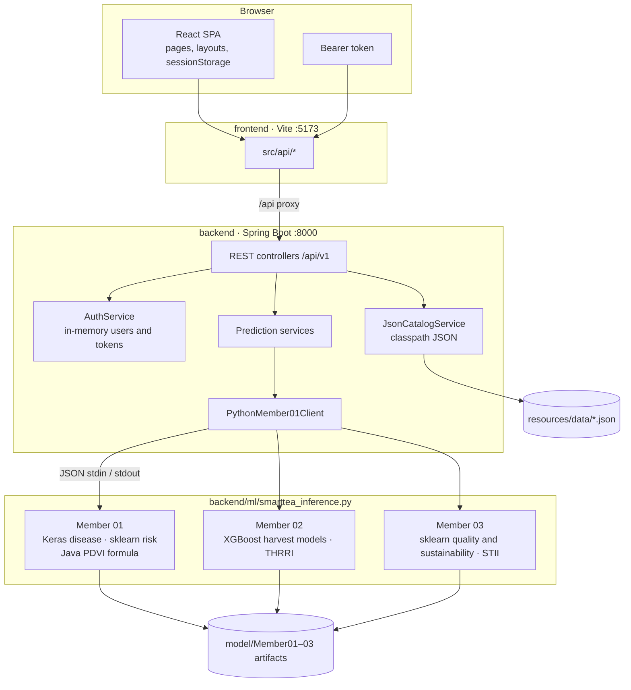
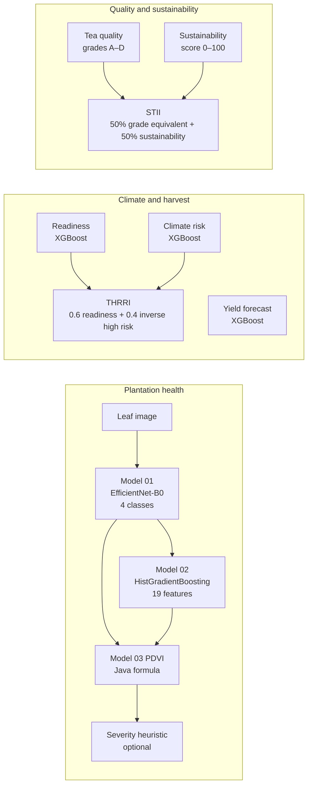
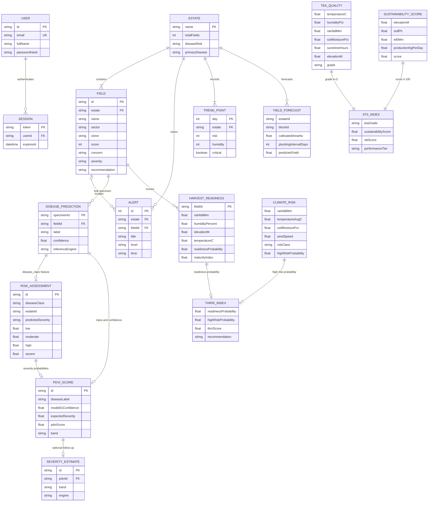

# SmartTea LK

SmartTea LK is a plantation-intelligence workspace for tea-estate supervisors. It brings three model groups together in one dashboard: leaf and disease health, harvest and climate, and tea quality with sustainability.

Supervisors sign in, open the Plantation Command Centre, and work through scored fields, alerts, and model runs for estates such as Nuwara Eliya, Dimbula, and Kandy Ridge. Disease, risk, and PDVI results for the current leaf specimen stay in the browser session so the next page can continue the same run.

## What the product covers

| Workspace | Routes | What it does |
|-----------|--------|----------------|
| Command Centre | `/` | Estate KPIs, priority fields, 30-day risk trend, alerts |
| Plantation health | `/disease`, `/risk`, `/pdvi`, `/severity` | Leaf-image disease class, 19-feature environmental risk, PDVI index, optional severity heuristic |
| Climate and harvest | `/harvest/readiness`, `/harvest/forecasting`, `/harvest/risk`, `/harvest/thrri` | Readiness, yield, climate risk, and the THRRI composite |
| Quality and sustainability | `/intel/predictions`, `/intel/sustainability-assessment`, `/intel/index` | Tea grade, sustainability score, and the STII composite |
| Operations | `/alerts`, `/reports`, `/settings`, `/profile`, `/support` | Alert feed, reports, settings, and the signed-in profile |

PDVI (Plantation Disease Vulnerability Index) combines Model 01 confidence with Model 02 severity probabilities. THRRI (Tea Harvest Readiness and Risk Index) blends harvest-readiness probability with high climate-risk probability. STII (SmartTea Intelligence Index) blends tea grade with the sustainability score.

## Repository layout

```text
smarttea-lk-ai/
├── frontend/          React 19 + Vite UI (dev server on port 5173)
└── backend/
    ├── pom.xml        Spring Boot 3.3 / Java 17 API (port 8000)
    ├── ml/            Python inference entrypoint and pinned libraries
    └── src/main/
        ├── java/com/smarttea/lk/
        │   ├── web/          REST controllers
        │   ├── service/      Catalog, auth, and prediction services
        │   ├── auth/         In-memory users and bearer sessions
        │   └── model/        Member01, Member02, and Member03 artifacts
        └── resources/data/   JSON catalogs for dashboard, PDVI, harvest, and intel
```

Deeper notes live in [backend/README.md](backend/README.md), [backend/ml/README.md](backend/ml/README.md), and [frontend/README.md](frontend/README.md).

## Architecture

The browser talks only to the React app. In development, Vite proxies `/api` to the Spring Boot process. Spring serves catalog JSON for the command centre and shells out to one Python process for model inference. Python reads a JSON request on stdin and writes a JSON result on stdout.



### Request path

1. `RequireAuth` checks the bearer token stored by `AuthContext`. Guest routes are `/login` and `/signup`.
2. Page components call a client in `frontend/src/api/` (`dashboardApi`, `diseaseApi`, `riskApi`, `pdviApi`, `harvestApi`, `intelApi`, `authApi`).
3. `apiClient.js` sends `Authorization: Bearer …` and reads FastAPI-style errors shaped as `{ "detail": "…" }`.
4. A controller delegates to a service. Catalog endpoints copy seed JSON. Prediction endpoints build a task payload and call `PythonMember01Client`.
5. The client starts `python ml/smarttea_inference.py` with the backend directory as the working directory, passes `SMARTTEA_MODEL_ROOT` and `SMARTTEA_MEMBER01_ROOT`, and waits up to `smarttea.ml.process-timeout-seconds` (180s).
6. `smarttea_inference.py` routes `disease` and `risk` to `member01_inference.py`, and harvest, quality, sustainability, THRRI, and STII tasks to `member02_03_inference.py`. PDVI stays in Java (`PdviCalculationService`) and does not call Python.

Set `smarttea.ml.enabled=false` to run the API on catalog and heuristic responses without loading TensorFlow or the joblib models. Integration tests use that switch.

### Frontend structure

| Area | Role |
|------|------|
| `src/App.jsx` | Router, auth gate, command-centre shell (sidebar, top bar, field drawer, report modal) |
| `src/context/AuthContext.jsx` | Login, register, logout, current user |
| `src/context/DashboardContext.jsx` | Estate selection, field drawer, report modal, dashboard payload |
| `src/layouts/` | Harvest and plantation-intel page frames |
| `src/utils/leafWorkflow.js` | Session handoff: disease result → risk probabilities → PDVI |
| `src/components/` | Shared UI, plus `commandCentre/`, `disease/`, `harvest/`, and `intel/` |

### Backend structure

| Package | Role |
|---------|------|
| `web` | HTTP API: auth, dashboard, alerts, disease, risk, PDVI, severity, harvest, intel, ML status |
| `service` | Business logic and the Python bridge |
| `auth` | `AuthUser`, `AuthSession`, BCrypt passwords, bearer tokens |
| `config` | CORS, ML paths, demo-user settings |
| `model/Member01` | `final_tea_disease_model.keras`, risk `.joblib`, PDVI notebook formula |
| `model/Member02` | Readiness, yield, and climate XGBoost joblibs, plus `thrri_calculator_final.py` |
| `model/Member03` | Tea-quality and sustainability joblibs, plus `stii_engine.py` |

### Model pipeline



Disease classes, in model order, are Blister Blight, Grey Blight, Red Rust, and Healthy (`backend/ml/class_names.json`). A Healthy prediction forces PDVI to 0. Any other class needs severity probabilities for Low, Moderate, High, and Severe that sum to about 1. The score is `100 × √(confidence × expected severity)` and is capped at 100. Bands are Minimal, Low, Moderate, and Substantial Risk.

## Entity-relationship diagram

Accounts and sessions live in memory for the life of the API process. Estate narrative data (fields, alerts, trends, default feature rows) is loaded from JSON under `backend/src/main/resources/data/`. Model outputs are computed per request and, for the leaf workflow, kept in the browser. The diagram is the logical model those payloads follow.



Relationships that matter in the UI:

- A user has many sessions. A normal token lasts 24 hours; “remember me” lasts 30 days. Passwords are stored as BCrypt hashes.
- An estate has many fields. A field may have alerts. The command centre also stores a 30-day trend of risk and humidity.
- One leaf session links a disease prediction to a risk assessment and then to one PDVI score. Severity estimation is a separate research heuristic (`java-context-heuristic-v1`).
- THRRI is derived from a readiness probability and a high-risk probability. Recommendation bands are Consider Harvesting (≥ 75), Monitor Conditions (≥ 50), and Delay and Reassess.
- STII is `0.5 × grade equivalent + 0.5 × sustainability score`. Grade equivalents are A 92.5, B 77.5, C 60, D 42.5. Tiers are Excellent (≥ 85), Good (≥ 70), Moderate (≥ 55), and Needs Improvement.

## How to run

Use two terminals. Start the API first, then the UI. Run commands from this repository root unless a step says otherwise.

### Prerequisites

| Tool | Version used by this repo |
|------|---------------------------|
| JDK | 17 |
| Maven | 3.9+ (any Maven that can build Spring Boot 3.3) |
| Python | 3.10+ with `pip` |
| Node.js | 20.19+ or 22.12+ (Vite 8) |
| npm | ships with Node.js |

Python packages are pinned for the saved models: **scikit-learn 1.6.1**, **XGBoost 1.7.6**, and **TensorFlow ≥ 2.16**. Newer XGBoost builds often fail to load the Member 02 joblibs.

### 1. Python models

From `backend/`:

```powershell
cd backend
python -m pip install -r ml/requirements.txt
```

Confirm the interpreter:

```powershell
python -c "import sklearn, xgboost, tensorflow; print('ml-ok')"
```

Optional smoke test (Member 02 and Member 03 tasks; it does not upload a leaf image):

```powershell
python ml/smoke_test.py
```

### 2. Backend

The process must be started with `backend/` as the working directory so `smarttea.ml.*` paths resolve.

```powershell
cd backend
mvn spring-boot:run
```

On Windows, if Maven cannot see JDK 17, set `JAVA_HOME` first:

```powershell
$env:JAVA_HOME = "C:\Program Files\Java\jdk-17"
mvn spring-boot:run
```

The API listens on **http://127.0.0.1:8000**.

Check it:

```text
GET http://127.0.0.1:8000/health
GET http://127.0.0.1:8000/api/v1/ml/status
```

`/api/v1/ml/status` should report `ok: true` and artifact flags when the Keras and joblib files are present. ML settings are in `backend/src/main/resources/application.properties` (`smarttea.ml.enabled`, `smarttea.ml.python-executable`, model roots).

### 3. Frontend

In a second terminal, from `frontend/`:

```powershell
cd frontend
npm install
npm run dev
```

Open **http://127.0.0.1:5173**. The dev server binds IPv4 on port 5173 and proxies `/api` to `http://127.0.0.1:8000`. Override the proxy with `VITE_API_PROXY_TARGET` if the API is elsewhere. Leave `VITE_API_BASE_URL` empty so the browser uses the same origin and the proxy (see `frontend/.env.example`).

### 4. Sign in

A demo account is seeded when `smarttea.auth.seed-demo-user=true`:

| Field | Value |
|-------|--------|
| Email | `demo@smarttea.lk` |
| Password | `demo1234` |
| Name | Demo Estate Manager |

`/signup` registers another in-memory user. Restarting the API clears registered users and sessions; the demo account is created again on startup.

### Production-style UI build

With the API already running:

```powershell
cd frontend
npm run build
npm run preview
```

`vite preview` also serves on port 5173. The preview server does not proxy `/api`. Point `VITE_API_BASE_URL` at the API origin before `npm run build` if the UI and API are on different hosts. CORS allows `http://localhost:5173` and `http://127.0.0.1:5173`.

### Tests

```powershell
cd backend
mvn test
```

```powershell
cd frontend
npm test
```

Backend integration tests set `smarttea.ml.enabled=false`, so they do not require TensorFlow.

## API map

All JSON routes are under `/api/v1`. Authenticated calls from the UI send `Authorization: Bearer <token>`.

| Method | Path | Purpose |
|--------|------|---------|
| POST | `/api/v1/auth/register` | Create an account and session |
| POST | `/api/v1/auth/login` | Sign in (`rememberMe` extends the token) |
| GET | `/api/v1/auth/me` | Current user |
| POST | `/api/v1/auth/logout` | Revoke the bearer token |
| GET | `/api/v1/dashboard?days=30` | Estates, fields, alerts, trend |
| GET | `/api/v1/alerts?estate=&q=` | Filtered alerts |
| GET | `/api/v1/models/disease` | Disease model metadata |
| POST | `/api/v1/predict/disease` | Multipart leaf image (`file`) |
| GET | `/api/v1/risk/environmental` | Risk page snapshot |
| POST | `/api/v1/predict/environmental-risk` | Model 02 from a `features` object |
| GET | `/api/v1/pdvi` | PDVI page payload |
| POST | `/api/v1/predict/pdvi` | PDVI from disease class, confidence, and severity probabilities |
| GET | `/api/v1/models/severity` | Severity heuristic metadata |
| POST | `/api/v1/predict/severity` | Severity heuristic |
| GET | `/api/v1/harvest/readiness` | Readiness scores for seed fields |
| POST | `/api/v1/harvest/predict/readiness` | Readiness for a submitted feature row |
| GET | `/api/v1/harvest/forecasting` | Yield snapshot |
| POST | `/api/v1/harvest/predict/yield` | Yield inference |
| GET | `/api/v1/harvest/climate-risk` | Climate-risk snapshot |
| POST | `/api/v1/harvest/predict/climate-risk` | Climate-risk inference |
| GET | `/api/v1/harvest/thrri` | THRRI from default probabilities |
| POST | `/api/v1/harvest/predict/thrri` | THRRI from submitted probabilities |
| GET | `/api/v1/intel/overview` | Intel workspace snapshot |
| GET | `/api/v1/intel/sustainability-assessment` | Sustainability snapshot |
| POST | `/api/v1/intel/predict/tea-quality` | Tea grade |
| POST | `/api/v1/intel/predict/sustainability` | Sustainability score |
| POST | `/api/v1/intel/predict/stii` | STII from grade and score |
| POST | `/api/v1/intel/predict/quality-stii` | Quality, sustainability, and STII in one call |
| GET | `/api/v1/models/member01/status` | Member 01 artifact check |
| GET | `/api/v1/ml/status` | Python ping and artifact flags |
| GET | `/health` | Process health |

Multipart uploads accept up to 15 MB. Disease inference expects an image; the Keras model resizes it to 224×224 RGB.

## Configuration reference

| Setting | Default | Meaning |
|---------|---------|---------|
| `server.port` | `8000` | API port; matches the Vite proxy |
| `smarttea.cors.allowed-origins` | localhost and 127.0.0.1 on 5173 | Browser origins allowed to call `/api/**` |
| `smarttea.ml.enabled` | `true` | `false` skips Python and uses catalog or heuristic results |
| `smarttea.ml.python-executable` | `python` | Interpreter on `PATH` |
| `smarttea.ml.inference-script` | `ml/smarttea_inference.py` | Relative to `backend/` |
| `smarttea.ml.model-root` | `src/main/java/com/smarttea/lk/model` | Folder that contains `Member01`, `Member02`, `Member03` |
| `smarttea.auth.demo-email` / `demo-password` | `demo@smarttea.lk` / `demo1234` | Local demo sign-in |
