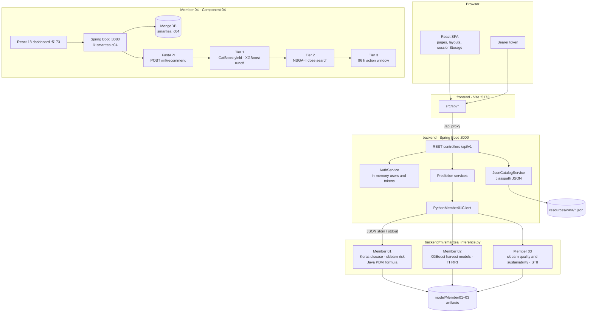
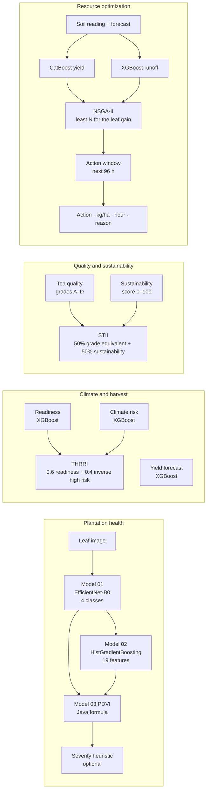
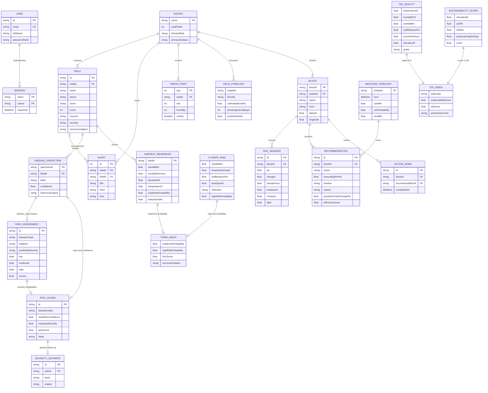
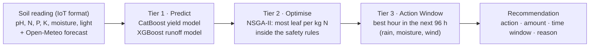

# SmartTea LK

SmartTea LK is a plantation-intelligence workspace for tea-estate supervisors. It brings four frameworks together: leaf and disease health, harvest and climate, tea quality and sustainability, and resource optimization with intervention planning.

Supervisors sign in, open the Plantation Command Centre, and work through scored fields, alerts, and model runs for estates such as Nuwara Eliya, Dimbula, and Kandy Ridge. Disease, risk, and PDVI results for the current leaf specimen stay in the browser session so the next page can continue the same run. Member 04 takes the next step for a block: from the live soil reading and the weather forecast it chooses the action, the amount, and the hour.

## What the product covers

| Workspace | Routes | What it does |
|-----------|--------|----------------|
| Command Centre | `/` | Estate KPIs, priority fields, 30-day risk trend, alerts |
| Plantation health | `/disease`, `/risk`, `/pdvi`, `/severity` | Leaf-image disease class, 19-feature environmental risk, PDVI index, optional severity heuristic |
| Climate and harvest | `/harvest/readiness`, `/harvest/forecasting`, `/harvest/risk`, `/harvest/thrri` | Readiness, yield, climate risk, and the THRRI composite |
| Quality and sustainability | `/intel/predictions`, `/intel/sustainability-assessment`, `/intel/index` | Tea grade, sustainability score, and the STII composite |
| Resource optimization | Component 04 tabs: Demo scenarios, Recommendation, Enter reading, Weather forecast, History | Fertilizer, irrigation, fungicide, and dolomite: amount per hectare and a time window |
| Operations | `/alerts`, `/reports`, `/settings`, `/profile`, `/support` | Alert feed, reports, settings, and the signed-in profile |

PDVI (Plantation Disease Vulnerability Index) combines Model 01 confidence with Model 02 severity probabilities. THRRI (Tea Harvest Readiness and Risk Index) blends harvest-readiness probability with high climate-risk probability. STII (SmartTea Intelligence Index) blends tea grade with the sustainability score. Member 04’s recommendation is the intervention plan: action, kilograms per hectare, a window inside the next 96 hours, and the reason.  
  
**Authors:**  
Member 01 - **Yugen S**  
Member 02 - **Hansani G E P**  
Member 03 - **WICKRAMASINGHE W.A.S.S.B**

## Repository layout

Members 01–03 are the application in this repository:

```text
smarttea-lk-ai/
├── frontend/          React 19 + Vite UI (dev server on port 5173)
├── backend/
│   ├── pom.xml        Spring Boot 3.3 / Java 17 API (port 8000)
│   ├── ml/            Python inference entrypoint and pinned libraries
│   └── src/main/
│       ├── java/com/smarttea/lk/
│       │   ├── web/          REST controllers
│       │   ├── service/      Catalog, auth, and prediction services
│       │   ├── auth/         In-memory users and bearer sessions
│       │   └── model/        Member01, Member02, and Member03 artifacts
│       └── resources/data/   JSON catalogs for dashboard, PDVI, harvest, and intel
└── Readme/            Member 01–03 framework guides
```

Member 04 (Component 04) is a second process layout. Its public API is Spring Boot on port 8080 with MongoDB, and its models run in a FastAPI service:

```text
├── src/
│   ├── data/          pipeline: build_real, generate_hybrid, build_model_ready, check_data
│   ├── models/        Tier 1: compare_models, overfit_check, explain_shap
│   ├── optimizer/     Tier 2: limits, soil_n, NSGA-II optimize, evaluate
│   ├── scheduler/     Tier 3: action_window
│   └── api/           FastAPI ML service (port 8000): main, live, explain
├── backend/           Spring Boot 3.3 + MongoDB (package lk.smarttea.c04, port 8080)
├── frontend/          React 18 + Tailwind 4 dashboard (port 5173)
├── data/              raw → interim → processed → model_ready
├── notebooks/         01_model_training.ipynb
├── tests/             pytest: live pipeline and optimizer rules
├── docs/              Formulas and Methods (PDF)
├── md_files/          project documentation
├── artifacts/         trained models (git-ignored, rebuilt by setup.bat)
└── setup.bat · start.bat · stop.bat
```

## Architecture

Members 01–03: the browser talks only to the React app. In development, Vite proxies `/api` to Spring Boot on port 8000. Spring serves catalog JSON for the command centre and shells out to one Python process for model inference. Python reads a JSON request on stdin and writes a JSON result on stdout.

Member 04: the React dashboard talks only to Spring Boot on port 8080. That API stores readings and recommendations in MongoDB and calls the FastAPI service (`POST /ml/recommend`) for the three-tier plan. An hourly job refreshes the Open-Meteo forecast and re-runs every block that has readings.

The two stacks both default to a dashboard on port 5173, and Member 04’s FastAPI service uses port 8000, the same port as the Members 01–03 API. Start one stack at a time.



### Request path

1. `RequireAuth` checks the bearer token stored by `AuthContext`. Guest routes are `/login` and `/signup`.
2. Page components call a client in `frontend/src/api/` (`dashboardApi`, `diseaseApi`, `riskApi`, `pdviApi`, `harvestApi`, `intelApi`, `authApi`).
3. `apiClient.js` sends `Authorization: Bearer …` and reads FastAPI-style errors shaped as `{ "detail": "…" }`.
4. A controller delegates to a service. Catalog endpoints copy seed JSON. Prediction endpoints build a task payload and call `PythonMember01Client`.
5. The client starts `python ml/smarttea_inference.py` with the backend directory as the working directory, passes `SMARTTEA_MODEL_ROOT` and `SMARTTEA_MEMBER01_ROOT`, and waits up to `smarttea.ml.process-timeout-seconds` (180s).
6. `smarttea_inference.py` routes `disease` and `risk` to `member01_inference.py`, and harvest, quality, sustainability, THRRI, and STII tasks to `member02_03_inference.py`. PDVI stays in Java (`PdviCalculationService`) and does not call Python.

Set `smarttea.ml.enabled=false` to run the API on catalog and heuristic responses without loading TensorFlow or the joblib models. Integration tests use that switch.

Member 04 request path:

1. A sensor, or the **Enter reading** tab, posts an IoT JSON reading to `POST /api/readings` on port 8080.
2. Spring stores the reading and calls FastAPI `POST /ml/recommend` with the block, its readings, and the raw forecast.
3. Tier 1 predicts plucking-round yield (CatBoost) and fertilizer washed away by forecast rain (XGBoost, monotone in rain).
4. Tier 2 searches nitrogen dose and irrigation with NSGA-II inside the safety rules. A dose is kept only when each kilogram of nitrogen adds at least 3.5 kg of green leaf.
5. Tier 3 picks an hour in the next 96 hours: at most 5 mm rain and 30% rain chance in the 12 hours after fertilizer, soil moisture in band, wind at most 4 m/s for spraying, working hours 06:00–16:00. Rules can add fungicide, dolomite when pH is below 4.45, or irrigation.
6. Spring saves the recommendation. The dashboard reads it from `GET /api/blocks/{id}/recommendation` and can mark it done.

### Frontend structure

| Area | Role |
|------|------|
| `src/App.jsx` | Router, auth gate, command-centre shell (sidebar, top bar, field drawer, report modal) |
| `src/context/AuthContext.jsx` | Login, register, logout, current user |
| `src/context/DashboardContext.jsx` | Estate selection, field drawer, report modal, dashboard payload |
| `src/layouts/` | Harvest and plantation-intel page frames |
| `src/utils/leafWorkflow.js` | Session handoff: disease result → risk probabilities → PDVI |
| `src/components/` | Shared UI, plus `commandCentre/`, `disease/`, `harvest/`, and `intel/` |

### Backend structure

| Package | Role |
|---------|------|
| `web` | HTTP API: auth, dashboard, alerts, disease, risk, PDVI, severity, harvest, intel, ML status |
| `service` | Business logic and the Python bridge |
| `auth` | `AuthUser`, `AuthSession`, BCrypt passwords, bearer tokens |
| `config` | CORS, ML paths, demo-user settings |
| `model/Member01` | `final_tea_disease_model.keras`, risk `.joblib`, PDVI notebook formula |
| `model/Member02` | Readiness, yield, and climate XGBoost joblibs, plus `thrri_calculator_final.py` |
| `model/Member03` | Tea-quality and sustainability joblibs, plus `stii_engine.py` |

Member 04 services, in the Component 04 tree:

| Area | Role |
|------|------|
| `src/api` | FastAPI ML service. The dashboard never calls it directly |
| `src/models` | Tier 1 training and comparison of seven yield and runoff models |
| `src/optimizer` | Tier 2 limits, soil-nitrogen response, NSGA-II, and the 2025 closed-loop evaluation |
| `src/scheduler` | Tier 3 action window |
| `src/data` | Real weather and soil, simulated management, model-ready tables |
| `backend` (`lk.smarttea.c04`) | Public API, MongoDB, hourly forecast refresh |
| `frontend` | Recommendation, IoT entry, forecast, history, and demo scenarios |

### Model pipeline



Disease classes, in model order, are Blister Blight, Grey Blight, Red Rust, and Healthy (`backend/ml/class_names.json`). A Healthy prediction forces PDVI to 0. Any other class needs severity probabilities for Low, Moderate, High, and Severe that sum to about 1. The score is `100 × √(confidence × expected severity)` and is capped at 100. Bands are Minimal, Low, Moderate, and Substantial Risk.

## Entity-relationship diagram

Members 01–03 keep accounts and sessions in memory for the life of the API process. Estate narrative data (fields, alerts, trends, default feature rows) is loaded from JSON under `backend/src/main/resources/data/`. Model outputs are computed per request and, for the leaf workflow, kept in the browser. Member 04 stores blocks, soil readings, forecasts, recommendations, and completed actions in MongoDB database `smarttea_c04`. The diagram is the logical model those payloads follow. E01–E03 line up with the command-centre estates Nuwara Eliya, Hatton / Dimbula, and Kandy; E04 and E05 add Ratnapura and Deniyaya / Matara.



Relationships that matter in the UI:

- A user has many sessions. A normal token lasts 24 hours; “remember me” lasts 30 days. Passwords are stored as BCrypt hashes.
- An estate has many fields. A field may have alerts. The command centre also stores a 30-day trend of risk and humidity.
- One leaf session links a disease prediction to a risk assessment and then to one PDVI score. Severity estimation is a separate research heuristic (`java-context-heuristic-v1`).
- THRRI is derived from a readiness probability and a high-risk probability. Recommendation bands are Consider Harvesting (≥ 75), Monitor Conditions (≥ 50), and Delay and Reassess.
- STII is `0.5 × grade equivalent + 0.5 × sustainability score`. Grade equivalents are A 92.5, B 77.5, C 60, D 42.5. Tiers are Excellent (≥ 85), Good (≥ 70), Moderate (≥ 55), and Needs Improvement.
- Member 04: each estate has blocks (50 blocks across E01–E05). A block has many soil readings and many recommendations. A recommendation is timed from the estate forecast and may be closed by one completed action. The example plan is block `E03-B07`, “Apply fertilizer”, 135 kg/ha, window `2026-10-22 06:00–10:00`.

## How to run

Members 01–03 use two terminals in this repository: the API first, then the UI. Member 04 uses its own setup (`setup.bat`, then `start.bat`) and its own ports. Run one stack at a time so port 5173 and port 8000 are free. Member 04’s Spring API listens on **8080**, and its database is MongoDB `smarttea_c04`. The full Component 04 procedure is under [Getting started (Windows)](#getting-started-windows).

### Prerequisites

| Tool | Version used by this repo |
|------|---------------------------|
| JDK | 17 |
| Maven | 3.9+ (any Maven that can build Spring Boot 3.3) |
| Python | 3.10+ with `pip` |
| Node.js | 20.19+ or 22.12+ (Vite 8) |
| npm | ships with Node.js |

Python packages are pinned for the saved models: **scikit-learn 1.6.1**, **XGBoost 1.7.6**, and **TensorFlow ≥ 2.16**. Newer XGBoost builds often fail to load the Member 02 joblibs.

### 1. Python models

From `backend/`:

```powershell
cd backend
python -m pip install -r ml/requirements.txt
```

Confirm the interpreter:

```powershell
python -c "import sklearn, xgboost, tensorflow; print('ml-ok')"
```

Optional smoke test (Member 02 and Member 03 tasks; it does not upload a leaf image):

```powershell
python ml/smoke_test.py
```

### 2. Backend

The process must be started with `backend/` as the working directory so `smarttea.ml.*` paths resolve.

```powershell
cd backend
mvn spring-boot:run
```

On Windows, if Maven cannot see JDK 17, set `JAVA_HOME` first:

```powershell
$env:JAVA_HOME = "C:\Program Files\Java\jdk-17"
mvn spring-boot:run
```

The API listens on **http://127.0.0.1:8000**.

Check it:

```text
GET http://127.0.0.1:8000/health
GET http://127.0.0.1:8000/api/v1/ml/status
```

`/api/v1/ml/status` should report `ok: true` and artifact flags when the Keras and joblib files are present. ML settings are in `backend/src/main/resources/application.properties` (`smarttea.ml.enabled`, `smarttea.ml.python-executable`, model roots).

### 3. Frontend

In a second terminal, from `frontend/`:

```powershell
cd frontend
npm install
npm run dev
```

Open **http://127.0.0.1:5173**. The dev server binds IPv4 on port 5173 and proxies `/api` to `http://127.0.0.1:8000`. Override the proxy with `VITE_API_PROXY_TARGET` if the API is elsewhere. Leave `VITE_API_BASE_URL` empty so the browser uses the same origin and the proxy (see `frontend/.env.example`).

### 4. Sign in

A demo account is seeded when `smarttea.auth.seed-demo-user=true`:

| Field | Value |
|-------|--------|
| Email | `demo@smarttea.lk` |
| Password | `demo1234` |
| Name | Demo Estate Manager |

`/signup` registers another in-memory user. Restarting the API clears registered users and sessions; the demo account is created again on startup.

### Production-style UI build

With the API already running:

```powershell
cd frontend
npm run build
npm run preview
```

`vite preview` also serves on port 5173. The preview server does not proxy `/api`. Point `VITE_API_BASE_URL` at the API origin before `npm run build` if the UI and API are on different hosts. CORS allows `http://localhost:5173` and `http://127.0.0.1:5173`.

### Tests

```powershell
cd backend
mvn test
```

```powershell
cd frontend
npm test
```

Backend integration tests set `smarttea.ml.enabled=false`, so they do not require TensorFlow.

## API map

Members 01–03 JSON routes are under `/api/v1` on port 8000. Authenticated calls from that UI send `Authorization: Bearer <token>`. Member 04 routes are on port 8080 and are listed in [Component 04 API](#component-04-api). The dashboard calls Spring only; Spring calls FastAPI `POST /ml/recommend`.

| Method | Path | Purpose |
|--------|------|---------|
| POST | `/api/v1/auth/register` | Create an account and session |
| POST | `/api/v1/auth/login` | Sign in (`rememberMe` extends the token) |
| GET | `/api/v1/auth/me` | Current user |
| POST | `/api/v1/auth/logout` | Revoke the bearer token |
| GET | `/api/v1/dashboard?days=30` | Estates, fields, alerts, trend |
| GET | `/api/v1/alerts?estate=&q=` | Filtered alerts |
| GET | `/api/v1/models/disease` | Disease model metadata |
| POST | `/api/v1/predict/disease` | Multipart leaf image (`file`) |
| GET | `/api/v1/risk/environmental` | Risk page snapshot |
| POST | `/api/v1/predict/environmental-risk` | Model 02 from a `features` object |
| GET | `/api/v1/pdvi` | PDVI page payload |
| POST | `/api/v1/predict/pdvi` | PDVI from disease class, confidence, and severity probabilities |
| GET | `/api/v1/models/severity` | Severity heuristic metadata |
| POST | `/api/v1/predict/severity` | Severity heuristic |
| GET | `/api/v1/harvest/readiness` | Readiness scores for seed fields |
| POST | `/api/v1/harvest/predict/readiness` | Readiness for a submitted feature row |
| GET | `/api/v1/harvest/forecasting` | Yield snapshot |
| POST | `/api/v1/harvest/predict/yield` | Yield inference |
| GET | `/api/v1/harvest/climate-risk` | Climate-risk snapshot |
| POST | `/api/v1/harvest/predict/climate-risk` | Climate-risk inference |
| GET | `/api/v1/harvest/thrri` | THRRI from default probabilities |
| POST | `/api/v1/harvest/predict/thrri` | THRRI from submitted probabilities |
| GET | `/api/v1/intel/overview` | Intel workspace snapshot |
| GET | `/api/v1/intel/sustainability-assessment` | Sustainability snapshot |
| POST | `/api/v1/intel/predict/tea-quality` | Tea grade |
| POST | `/api/v1/intel/predict/sustainability` | Sustainability score |
| POST | `/api/v1/intel/predict/stii` | STII from grade and score |
| POST | `/api/v1/intel/predict/quality-stii` | Quality, sustainability, and STII in one call |
| GET | `/api/v1/models/member01/status` | Member 01 artifact check |
| GET | `/api/v1/ml/status` | Python ping and artifact flags |
| GET | `/health` | Process health |

Multipart uploads accept up to 15 MB. Disease inference expects an image; the Keras model resizes it to 224×224 RGB.

## Configuration reference

| Setting | Default | Meaning |
|---------|---------|---------|
| `server.port` | `8000` | API port; matches the Vite proxy |
| `smarttea.cors.allowed-origins` | localhost and 127.0.0.1 on 5173 | Browser origins allowed to call `/api/**` |
| `smarttea.ml.enabled` | `true` | `false` skips Python and uses catalog or heuristic results |
| `smarttea.ml.python-executable` | `python` | Interpreter on `PATH` |
| `smarttea.ml.inference-script` | `ml/smarttea_inference.py` | Relative to `backend/` |
| `smarttea.ml.model-root` | `src/main/java/com/smarttea/lk/model` | Folder that contains `Member01`, `Member02`, `Member03` |
| `smarttea.auth.demo-email` / `demo-password` | `demo@smarttea.lk` / `demo1234` | Local demo sign-in |

Member 04 (Component 04) settings:

| Setting | Default | Meaning |
|---------|---------|---------|
| FastAPI | `http://localhost:8000` | Internal ML service. `GET /ml/health` reports loaded models. Do not bind this while the Members 01–03 API is on port 8000 |
| Spring Boot | `http://localhost:8080` | Public API the dashboard calls |
| Dashboard | `http://localhost:5173` | React 18 Vite app opened by `start.bat` |
| `MONGODB_URI` | `mongodb://localhost:27017/smarttea_c04` | Override with a git-ignored root `.env` for MongoDB Atlas |
| Optimizer rule | 3.5 kg green leaf per kg N | A nitrogen dose below this gain is not recommended |
| Action window | next 96 h, 06:00–16:00 | Rain, moisture, and wind gates are in the Member 04 section below |

## Member 04 - Tea Plantation Resource Optimization and Intervention Planning Framework

Member 04 decides, for each tea block, what to do next, how much, and when: fertilizer, irrigation, fungicide, and soil-pH correction. It uses the live soil reading and the weather forecast so each block gets the least input for the most growth, and nothing is applied just before heavy rain.

The sections below are the Component 04 project record : how the three tiers work, the 2025 results, the hybrid dataset, Windows setup, the dashboard, the API, tests, and sources. `setup.bat` and `start.bat` launch that stack: FastAPI on port 8000, Spring Boot on port 8080, MongoDB, and the React dashboard on port 5173.

**Scope:** agronomic only. No cost, labour, or machinery variables.

**Author:** Ranawana R.M.S.V

    

### Contents

- [How it works](#how-it-works)
- [Results](#results)
- [Data](#data)
- [Getting started (Windows)](#getting-started-windows)
- [Using the dashboard](#using-the-dashboard)
- [Repository structure](#repository-structure)
- [Reproduce the data and models](#reproduce-the-data-and-models)
- [Component 04 API](#component-04-api)
- [Component 04 tests](#component-04-tests)
- [Documentation](#documentation)
- [Limitations](#limitations)
- [Data sources and licences](#data-sources-and-licences)

### How it works

Every new reading, and every hour as the forecast changes, a block's data runs through three tiers:



| Tier | What it does |
|---|---|
| **1. Prediction** | A **CatBoost** model predicts the yield of a plucking round. An **XGBoost** model predicts the % of fertilizer that rain will wash away, using the *forecast* rain, slope and soil moisture; more forecast rain can never lower its prediction (monotone rule). |
| **2. Optimizer** | **NSGA-II** (pymoo) searches nitrogen doses and irrigation within the operational limits. A learned soil-N response carries each dose's effect over the next 90 days, and the runoff model picks the product that loses least. A dose is recommended only if each kg of N adds at least 3.5 kg of green leaf. |
| **3. Action Window** | Scans the hourly forecast for the best time: at most 5 mm rain and 30 % rain chance in the 12 h after fertilizer, soil moisture in the allowed band, wind ≤ 4 m/s for spraying, working hours 06:00–16:00. Rule-based checks add fungicide (blister-blight risk), dolomite (pH < 4.45) and irrigation (soil below the trigger, little rain coming). |

Example output:

```json
{"block_id": "E03-B07", "action": "Apply fertilizer", "amount_kg_per_ha": 135,
 "window": "2026-10-22 06:00–10:00", "reason": "Soil moisture in band; 0.4 mm rain in the 12 h after",
 "predicted_yield_change_pct": 10.9, "efficiency_score": 0.87}
```

Every formula (model training, metrics, soil-N response, optimizer, scheduler rules and the data simulation) is written out in [`docs/SmartTea_LK_C04_Formulas_and_Methods.pdf`](docs/SmartTea_LK_C04_Formulas_and_Methods.pdf).

### Results

Settings were chosen on 2024 data only, and 2025 was scored once. "New blocks + new year" is the hardest test: blocks and a year the model never saw.

| Model | Measure | Test year 2025 | New blocks + new year |
|---|---|---|---|
| Yield (CatBoost) | R² (variation explained) | **0.91** (MAE 1.63 kg/ha/day) | **0.80** |
| Runoff risk, high / low (XGBoost) | Accuracy / F1 | **0.81 / 0.82** (guessing: 0.54) | **0.79 / 0.81** |
| Runoff amount (XGBoost) | R² | 0.57 | 0.44 |
| Runoff amount with the rain that actually fell (upper bound) | R² | 0.94 | 0.90 |

- **Forecast error, not the model, limits runoff prediction:** the same model reaches 0.94 when given the real rain.
- **Seven models were compared** (Ridge, Random Forest, HistGradientBoosting, XGBoost, LightGBM, CatBoost, MLP); the four boosting models were within about 0.03 of each other.

**Optimizer, full-year closed-loop test on 2025 (all 50 blocks):**

| Per hectare per year | Historical practice | Optimizer |
|---|---|---|
| Nitrogen applied | 198 kg | 182 kg (−8 %) |
| Nitrogen lost to runoff | 59 kg | 36 kg (−40 %) |
| Predicted green leaf | 7,519 kg | 7,776 kg (+3.4 %) |
| Safety-rule breaks | 0 | 0 |

The optimizer's yield figures are model predictions, not field measurements.

### Data

The dataset is a **hybrid**: the environment is real, and the farm management on top of it is simulated, because no public dataset has block-level tea sensors, fertilizer timing and yield for Sri Lanka.

- **Study area:** 5 real tea-growing locations × 10 blocks = **50 blocks**, daily, **2021-01-01 to 2025-12-31**. The estate names E01–E05 are labels; the places are real.

| Estate | Region | Zone | Latitude | Longitude |
|---|---|---|---|---|
| E01 | Nuwara Eliya | Up-country | 6.97 | 80.78 |
| E02 | Hatton / Dimbula | Up-country | 6.89 | 80.60 |
| E03 | Kandy | Mid-country | 7.25 | 80.65 |
| E04 | Ratnapura | Low-country | 6.68 | 80.40 |
| E05 | Deniyaya / Matara | Low-country | 6.34 | 80.56 |

| Real | Simulated on the real weather and soil |
|---|---|
| Hourly weather and rain timing (ERA5) | Fertilizer, irrigation, fungicide and dolomite decisions |
| Issued weather forecasts (real from 2024-01-20) | Crop growth and yield |
| Soil properties for every block (SoilGrids) | Fertilizer runoff amounts |
| National tea production by elevation | Sensor noise and ~1.5 % missing readings |

- **Data layers:** `data/raw` (original downloads + `MANIFEST.csv` with SHA-256 checksums) → `data/interim/real` → `data/processed/hybrid` → `data/model_ready` (feed-ready tables).
- **Training tables:**
  - yield: 9,053 plucking rounds, 57 inputs;
  - runoff: 850 fertilizer applications, 24 inputs.
- **Only decision-time information is used as model input;** facts known only afterwards are prefixed `hindsight__`.
- **Data guide and dictionary:** [`md_files/data/README.md`](md_files/data/README.md) and [`md_files/data/DATA_DICTIONARY.md`](md_files/data/DATA_DICTIONARY.md).

### Getting started (Windows)

**One-time setup on a new PC.** Double-click `setup.bat` (about 20–30 minutes the first time):

1. Installs what is missing with winget: Python 3.14, Java 21 (Temurin), Node.js LTS, MongoDB. It downloads Maven 3.9.9 from Apache and checks its checksum.
2. Creates `.venv` with the exact package versions in `requirements-lock.txt`, installs the dashboard packages and builds the backend.
3. Retrains the models (`artifacts/` is not stored in Git), then checks the data checksums and runs the tests.

Requirements: Windows 10 or 11 with winget ("App Installer" from the Microsoft Store) and an internet connection. Accept the administrator prompts.

**Day to day:**

| File | What it does |
|---|---|
| `start.bat` | Starts MongoDB (if stopped), the ML service, the backend and the dashboard, each in its own window, then opens http://localhost:5173 |
| `stop.bat` | Stops all three (MongoDB keeps running as a Windows service) |
| `setup.bat` | Run again after code changes: rebuilds the backend cleanly. `setup.bat retrain` also retrains the models |

**Manual start** (three terminals, from the Component 04 project root):

```bash
# 1. ML service (FastAPI)            http://localhost:8000/docs
.venv\Scripts\activate
uvicorn src.api.main:app --port 8000

# 2. Backend (Spring Boot + MongoDB)  http://localhost:8080
cd backend
mvn spring-boot:run

# 3. Dashboard (React + Vite)          http://localhost:5173
cd frontend
npm run dev
```

The backend uses `mongodb://localhost:27017/smarttea_c04` by default. To use MongoDB Atlas instead, put `MONGODB_URI=...` in a `.env` file in the project root (git-ignored).

### Using the dashboard

| Tab | Purpose |
|---|---|
| **Demo scenarios** | Ready-made situations (e.g. dry weather where fertilizer is recommended) that fill the reading form |
| **Recommendation** | The action, amount, time window and a plain-language reason, a 4-day best-time planner, and **Mark as done** |
| **Enter reading (IoT)** | Manual entry in exactly the JSON format a future IoT sensor will send |
| **Weather forecast** | The live Open-Meteo forecast with the hourly fertilizer runoff scan |
| **History** | Past recommendations, sensor readings and actions marked as done, with delete buttons |

### Repository structure

```
├── src/
│   ├── data/        data pipeline: build_real, generate_hybrid, build_model_ready, check_data, load
│   ├── models/      Tier 1: compare_models (7 models), overfit_check, explain_shap
│   ├── optimizer/   Tier 2: limits, context, soil_n, optimize (NSGA-II), evaluate
│   ├── scheduler/   Tier 3: action_window
│   └── api/         FastAPI ML service: main, live, explain
├── backend/         Spring Boot 3.3 public API + MongoDB (package lk.smarttea.c04)
├── frontend/        React 18 + Tailwind 4 + Vite dashboard
├── data/            raw → interim → processed → model_ready (see md_files/data/README.md)
├── notebooks/       01_model_training.ipynb (trains and saves both models, with charts)
├── tests/           pytest: live API pipeline + optimizer rules
├── docs/            Formulas and Methods (PDF)
├── md_files/        project documentation (Markdown)
├── artifacts/       trained models and reports (git-ignored, rebuilt by setup.bat)
├── setup.bat · start.bat · stop.bat
└── requirements.txt · requirements-lock.txt
```

### Reproduce the data and models

From the Component 04 project root with the virtual environment active:

```bash
# data pipeline (always writes to new folders; frozen data is never overwritten)
python -m src.data.build_real                       # raw -> data/interim/real_rebuilt (verifies checksums)
python src/data/generate_hybrid.py --out data/processed/hybrid_regen --real-data data/interim/real
python -m src.data.build_model_ready                # -> data/model_ready
python -m src.data.check_data                       # audit every data layer

# Tier 1 models
python -m src.models.compare_models                 # compares 7 models, saves the best per task (~10 min)
python -m src.models.explain_shap                   # SHAP explanations -> artifacts/reports/shap/
# or open notebooks/01_model_training.ipynb and Run All (~2 min)

# Tier 2 optimizer
python -m src.optimizer.soil_n                      # fit the soil-N response model
python -m src.optimizer.optimize --block E03-B07 --date 2025-06-01
python -m src.optimizer.evaluate                    # 2025 closed-loop test
```

The hybrid data regenerates exactly with the fixed seed (42), and retraining gives identical models.

### Component 04 API

**Public API (Spring Boot, port 8080):**

| Method | Endpoint | Purpose |
|---|---|---|
| POST | `/api/readings` | Store a reading (IoT format) and re-run the recommendation |
| GET | `/api/blocks/{id}/recommendation` | Latest recommendation |
| POST | `/api/blocks/{id}/recommendation` | Re-run now (optional `whatIf=dry\|wet`, `minAe`) |
| GET | `/api/blocks/{id}/recommendations` | Recommendation history |
| GET | `/api/forecast/{estateId}` | Open-Meteo forecast (cached for 60 min) |
| POST · GET | `/api/blocks/{id}/actions-done` | Mark an action as done / list them |
| DELETE | `/api/recommendations/{id}`, `/api/readings/{id}` | Delete one history item |
| GET | `/api/status`, `/api/estates`, `/api/blocks` | System status and reference data |

An hourly scheduled job refreshes the forecast and re-runs the recommendation for every block with readings.

**Internal ML service (FastAPI, port 8000):** `POST /ml/recommend` takes a block, its readings and the raw forecast, and returns the recommendation. `GET /ml/health` reports the loaded models and their scores. The dashboard never calls the ML service directly.

### Component 04 tests

```bash
python -m pytest tests -q
```

22 tests cover two areas:

- **Live pipeline:** forecasts, irrigation and spray rules, the gaps between repeated actions, and the pH trigger.
- **Optimizer:** it never breaks a dose, gap, pruning, annual-ceiling or irrigation rule.

### Documentation

| Document | Content |
|---|---|
| [`docs/SmartTea_LK_C04_Formulas_and_Methods.pdf`](docs/SmartTea_LK_C04_Formulas_and_Methods.pdf) | Every formula and parameter value |
| [`md_files/docs/SmartTea_LK_C04_Full_Project.md`](md_files/docs/SmartTea_LK_C04_Full_Project.md) | Full project record: design, results, decisions |
| [`md_files/data/README.md`](md_files/data/README.md) | Data layers, sources, rebuild steps |
| [`notebooks/01_model_training.ipynb`](notebooks/01_model_training.ipynb) | Model training with all outputs and charts |

### Limitations

- **Simulated management:** the models learn a simulated crop response on real weather and soil. Validation on real estate records (Tea Research Institute or a plantation company) is the main open step.
- **Placeholder parameters:** fertilizer rates, loss coefficients, the blight model and the 3.5 kg-leaf-per-kg-N threshold should be checked against TRI guidance.
- **New locations:** the yield model generalises to new blocks at known locations, not to a new estate.
- **Optimizer estimates:** the gains are model predictions from a one-year test, which understates the long-term cost of cutting nitrogen.

### Data sources and licences

| Data | Source | Licence |
|---|---|---|
| Hourly weather 2021–2025 (ERA5 / ERA5-Land) | [Open-Meteo Historical Weather API](https://open-meteo.com/en/docs/historical-weather-api) | CC BY 4.0 |
| Issued forecasts 2024–2025 | [Open-Meteo Previous Runs API](https://open-meteo.com/en/docs/previous-runs-api) | CC BY 4.0 |
| Weather cross-check | [NASA POWER](https://power.larc.nasa.gov/) | NASA open data |
| Soil properties (250 m) | [ISRIC SoilGrids 2.0](https://docs.isric.org/globaldata/soilgrids/) | CC BY 4.0 |
| National tea production by elevation | [Forbes & Walker Tea Brokers](https://www.forbestea.com/statistics-national-production) | Public reports; cited |

Every raw file is listed with its link, download date and SHA-256 checksum in [`data/raw/MANIFEST.csv`](data/raw/MANIFEST.csv).
